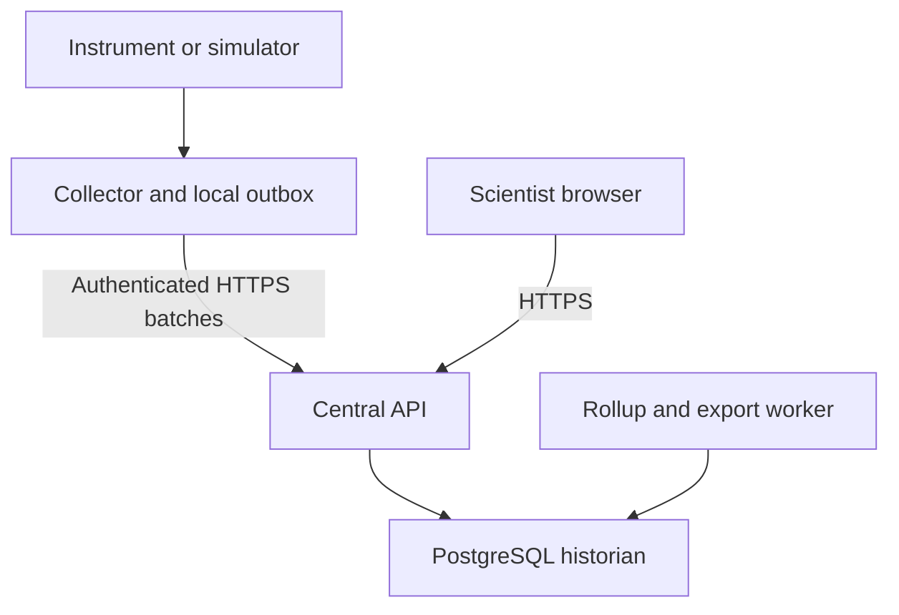

# Lab Instrument Monitor
## Product and engineering specification v0.3

**Status** Simulator-first implementation baseline · revised 6 November 2026  
**Companions** [ROADMAP.md](ROADMAP.md), [AGENTS.md](AGENTS.md), [CONTRIBUTING.md](CONTRIBUTING.md) and the ADRs in `docs/adr/`  
**License** MIT · **Confirmed baseline** Ubuntu 24.04 amd64, Python 3.12, PostgreSQL 16

## 1. Problem statement

Scientists need one intranet workspace to find enrolled instruments, tell which are delivering usable readings, and inspect what happened during experiments that may run for weeks. Today, a reading can remain on a controller display, in a vendor application, or in a file on an instrument PC. This makes it difficult to distinguish a real excursion from a dead sensor, compare temperature with a recorded setpoint, or recover the evidence after a workstation or network outage.

Build a read-only monitoring and scientific history service. A collector close to the instrument acquires the digital readings and buffers them locally. A central VM receives, stores and serves the history while users open or close their browsers independently. The first deliverable is a usable simulator-only installation with a furnace, a universal tensile testing machine and a fictional vacuum dilatometer. A differential scanning calorimeter (DSC) is a fourth profile that users can enable. Hardware integration follows when the group chooses a machine and supplies its interface details. Existing loggers and an eventual instrument-display-to-PC acquisition path are possible sources.

### Users and scope

| User | Primary workflow |
| --- | --- |
| Scientist | Find an instrument, check recency and quality, inspect a run, annotate an observation, compare traces and export evidence. |
| Instrument custodian | Enroll an assigned instrument, validate its channel map and reference measurement, manage maintenance and inspect diagnostics. |
| Site administrator | Provision collectors, grant lab-scoped access, verify deployment and backups, and recover or revoke a collector. |

Version 1 supports scalar numeric, Boolean and enumerated readings from documented digital sources at low rates. Source profiles can describe different protocols and multi-channel machines. The initial release ships the simulated profiles in §7 and a wizard for commissioning them. The same adapter boundary supports later instrument-specific connections once the corresponding interface is known. Waveforms, microscopy streams, closed-loop control, hard real-time acquisition, vendor application replacement and laboratory access enforcement are separate scopes. Experiments group continuously collected data by instrument and time range. Starting or ending a run in the browser creates a record only.

## 2. Repository fit and technology decisions

| Reference reviewed | Design implication |
| --- | --- |
| [ml_server README](https://github.com/kvmani/ml_server/blob/main/README.md) and [intranet configuration](https://github.com/kvmani/ml_server/blob/main/config/config.intranet.json) | The Flask gateway already links to independent tools. Add a catalog entry pointing to this service's configured intranet URL after pilot acceptance. Use separate application sessions and dependencies. |
| [ml_server_deploy README](https://github.com/kvmani/ml_server_deploy/blob/main/README.md), [manifest](https://github.com/kvmani/ml_server_deploy/blob/main/manifest.yml) and [runbook](https://github.com/kvmani/ml_server_deploy/blob/main/RUNBOOK.md) | Follow immutable component commits, browser-transfer archives, shared persistent state, scoped service restarts, read-only preflight and rollback rehearsal. The reviewed manifest documents direct intranet access for the existing suite. Provide an approved TLS endpoint for this service and verify the topology from a client PC. Provision PostgreSQL separately unless the deployment manifest gains an explicit, rehearsed prerequisite contract. |
| [LabAxes AGENTS.md](https://github.com/kvmani/LabAxes/blob/main/AGENTS.md), [pyproject.toml](https://github.com/kvmani/LabAxes/blob/main/pyproject.toml) and [air-gap guide](https://github.com/kvmani/LabAxes/blob/main/docs/operations/ubuntu-24-04-airgap.rst) | Align with its Python/FastAPI/PostgreSQL/Alembic/React stack and offline installation discipline. Allow an optional LabAxes resource ID as metadata. Keep commissioning, data access and uptime independent of LabAxes. |
| [project_management_software README](https://github.com/kvmani/project_management_software/blob/main/README.md) and [compatibility policy](https://github.com/kvmani/project_management_software/blob/main/docs/production_compatibility_policy.md) | Apply its practice of testing upgrades against a pinned running baseline and rehearsing on copies. Portal/catalog work must preserve existing routes and deployments. |

| Layer | Baseline choice and rationale |
| --- | --- |
| Central app | Separate repository and modular monolith. Python 3.12, FastAPI, Pydantic, SQLAlchemy 2, psycopg 3, Alembic, Uvicorn. Matches LabAxes patterns and leaves acquisition outside web worker lifetimes. PostgreSQL stores durable jobs. Use a separate worker for exports and rollups when needed. |
| Database | PostgreSQL 16 baseline on Ubuntu 24.04 with supported security updates. One database for metadata, permissions, audit, ingestion and scientific history. Start with an unpartitioned sample table, a channel/time B-tree and batched transactions. Benchmark before introducing monthly partitions, BRIN or a time-series extension. PostgreSQL partitioned unique keys must include the partition key. A later migration must preserve global replay identity via a separate identity ledger or equivalent proven design. |
| Collector | CPython 3.12 service, initially runnable on Windows 11 and Ubuntu. Use bounded synchronous adapter calls or worker isolation for blocking vendor drivers. SQLite WAL with FULL synchronization on a local fixed disk for the persistent outbox. Use a single owning process and serialized connection for spool I/O and checkpoints. Verify the actual linked SQLite build includes the upstream WAL-reset fix or a documented vendor backport. If the approved build lacks that fix, use a fully synchronized rollback journal and verify the same crash/throughput gates. Windows service with automatic startup and recovery for the real pilot, systemd on Linux. Keep vendor packages and drivers isolated at the edge. |
| Browser | React, TypeScript, Vite and Apache ECharts bundled locally. Custom scientific workflows and consistent chart semantics share one design system. Use relative API URLs and versioned, self-hosted static assets. |
| Live update | Begin with bounded HTTP polling every 2 seconds for the focused page and every 5 seconds for inventory. Re-query the displayed trailing window and merge by identity or replace the bounded snapshot. Abort old requests on filter change, back off on errors and reduce polling for hidden tabs. Measure concurrency before adding SSE. |
| Runtime | Ubuntu 24.04 amd64 VM, existing systemd convention where viable, nginx or institution-approved HTTPS ingress, managed local PostgreSQL. Separate release, configuration, database, spool, export and backup locations. Infrastructure services use least-privilege accounts. Separate schema migration and backup privileges from the runtime DB role. |
| Deferred | Broker, streaming platform, Redis, standalone historian extension, Grafana embedding, central hardware control and containers as a production prerequisite. Revisit each only for a measured requirement or operating constraint. |

The owner has confirmed the Ubuntu 24.04 / Python 3.12 / PostgreSQL 16 baseline against the real systems, and the repository is licensed MIT. Engineering standards, the definition of done and the dependency policy are in [CONTRIBUTING.md](CONTRIBUTING.md). Continuous integration runs only when manually dispatched; the single-command local gate `scripts/check.sh` is mandatory before every push (ADR 0005).

Use supported, pinned package versions available through approved mirrors or a hash-locked wheelhouse. Record direct/transitive licenses, SBOM and target platform. Set the center/edge compatibility window to current and previous protocol versions after the first upgrade and test both directions before advancing the minimum version. Review code licensing before copying from reference repos, including LabAxes' AGPL designation in its pyproject. Prefer integration contracts and independently implemented patterns.

## 3. Architecture and operating boundaries

- Assign each physical serial bus or exclusive vendor session to one collector process and serialize its requests. A slow device must have a bounded impact on other devices. Schedule with a monotonic clock. Do not fire a burst of missed polls after sleep or reconnection. On takeover, explicitly revoke or fence the prior acquisition assignment and record overlap or gaps.
- Default traffic policy permits only declared paths. The collector initiates connections to the approved ingestion host and reaches assigned instrument endpoints. The server has no generic instrument-network client. Where an isolated PC cannot reach the VM, provide a reviewed offline export/import bridge as a separate adapter and label it as delayed delivery. No live status promise applies there.
- Central availability, collector heartbeat, acquisition freshness and instrument process state are independent. Collection continues without logged-in users. During VM or network outages it continues only while the collector, source and spool remain functional. A sleeping PC, dead logger or full spool can create an unrecoverable interval.

## 4. Functional requirements

| ID | Requirement and observable outcome |
| --- | --- |
| REG-01 | Register a lab, location, instrument, collector assignment, adapter profile and named channels. Search by instrument, asset ID, lab and tags. Filter for receiving, stale, offline and maintenance. Retired instruments retain authorized history. Discovery lists local candidates only during explicit, bounded probes of approved interfaces. |
| LIVE-01 | Each row shows recent value with unit, last successful sample, acquisition state, collector state, and reason when degraded. Show both absolute time and age. A fixed valid temperature remains live when expected samples arrive. Display machine On/Off/Running only from a validated state channel or an explicitly labeled inference rule. |
| LIVE-02 | Instrument page shows channel tiles, synchronized plots, diagnostics summary and markers for configuration changes, missing intervals and run annotations. Browser connectivity changes immediately update a prominent status banner. Last good values show their original timestamp and age. |
| HIST-01 | Review the full 30-day window, then zoom to individual readings. Range presets 15 min, 1 h, 24 h, 7 d, 30 d and custom. Accept absolute or run-relative time. Support visible-window Y autoscale, fixed limits and independently grouped axes by dimension. Save personal views and explicitly shared lab templates. Support an engineering stress–strain XY view for tensile runs and a heat-flow-versus-temperature XY view for DSC runs. Both link back to the time series. |
| RUN-01 | Name and tag a run, link one instrument initially and record owner, window and notes. Allow backdated windows and annotations with audited corrections. Permit independent continuous telemetry outside runs. Support multiple linked instruments only after the single-instrument flow is proven. |
| ANA-01 | For a selected interval show min, max with timestamp, arithmetic mean of valid samples, count by quality and coverage where expected cadence is known. For approved furnace profiles add time within tolerance and excursions using documented duration rules. |
| EXP-01 | Export raw, filtered rows as CSV plus a manifest and export the current chart as PNG with labels, units, time range, time zone and resolution. Large exports run in a durable bounded worker. A separate authorized optional raw-evidence field can expose safe register words, never secrets. |
| ONB-01 | Commission a source using the wizard in §8. Preview readings with quality and units before activation. An interrupted wizard resumes its draft. A publish creates an immutable profile revision and records the collector's acknowledgement before activation is shown. |
| OPS-01 | Show collector connectivity, device errors, queue depth and age, central receive lag, disk headroom, clock status, failed exports, backup freshness and pending configuration. Give an operator next step per fault. Pilot alerts are in-app. Internal SMTP is optional after rollout testing. |
| SIM-01 | Seed the three core instruments defined in §7, with DSC selectable in the demo setup. Use the same acquisition, ingestion, query, dashboard and export paths for deterministic synthetic sources. Label simulation in the UI, provenance and exports. Test environments use separate credentials and databases. |

### Status vocabulary

Use distinct status fields for lifecycle (Draft, Active, Maintenance, Retired), collector connectivity (Never seen, Online, Offline, Revoked), acquisition (Waiting, Receiving, Degraded, Stale, Source unavailable, Paused), and instrument-reported process state (Unknown or a mapped device value). Show reasons such as “collector online · no response from controller” and “collector offline · last good reading at 14:03 IST”. Maintenance flags and notification suppression are audited and leave collection running by default. Explicit acquisition pause requires an authorized action and reason.

Starting defaults for periodic profiles: heartbeat every 10 s, offline after 30 s without a new authenticated heartbeat; freshness window max(3 × cadence, 5 s). Show bad-quality samples separately from no samples. Change-driven sources must define a liveness contract distinct from value change. Heartbeats never refresh the last-good sample, and replayed heartbeats or historical readings cannot reset freshness. Present server and collector clock health and central ingest lag alongside status. Only a centrally committed sample from the current acquisition assignment can support a Receiving badge. Separately report that the collector is sampling but delivery is delayed when heartbeat evidence supports it.

## 5. Data model and integrity

| Record | Required fields and rules |
| --- | --- |
| Lab, Instrument, Channel | Stable IDs, scope and lifecycle. Channel defines quantity, engineering unit, data type, expected cadence and display precision. Significant changes to meaning or physical dimension create a new channel. |
| Profile revision and calibration record | Immutable source mapping, adapter version, engineering conversion and validity interval, calibration/reference record, actor and approval. Capture the exact revision at acquisition; queued rows retain it after a configuration change. Avoid retroactive mutation of readings. Reprocessing creates a separately identified derived result. |
| Sample | Collector ID, persisted spool epoch and sequence form the global identity. Include channel and profile revision, typed value, optional stable acquisition frame ID for synchronous channel pairing, bounded optional raw value, source status/diagnostic, normalized quality, source time if supplied, collector capture time, server receive time, effective event time and clock confidence. Require finite numeric values. Preserve stable ordering with an identity tie-breaker. |
| Batch receipt and assignment | Immutable receipt with collector, batch ID, payload digest and outcome. Scoped credential identifies the collector independently of body fields. Persist assignment history and reject new acquisition after a fenced handover, while supporting explicitly bounded replay from the retired assignment. Use an acknowledged epoch/sequence cutoff for planned handover. After an unplanned takeover with an unknown cutoff, send old-collector data through supervised recovery instead of relaxing the fence. |
| Run | Stable ID `<instrument>.<run key>`, name, kind, source (`instrument` or `user`), simulation flag, program start, planned and actual end, end reason and bounded metadata (for example tensile specimen geometry or DSC sample mass). Instrument-reported runs are a projection of `run_started`/`run_ended` acquisition events, maintained idempotently in the ingest transaction; the events remain the source of truth. |
| Event, run annotation, view, export and audit | Scope every row. Separate operator edits and audit from telemetry. Record author, before/after or structured change, reason and time for administrative actions. Audit access-sensitive exports and configuration. Keep simulation origin, metric definitions and query context with exported results. |

Store time as UTC in PostgreSQL `timestamptz`, send RFC 3339 offsets and show Asia/Kolkata by default with a UTC toggle. Preserve source timestamps even when suspect. Each adapter declares whether source time means actual sample time, last value change or is absent. Choose a trusted actual sample time when available, otherwise collector capture time with a visible quality flag for clock anomalies. A collector with an untrustworthy clock retains evidence, but uncertain timestamps are identified and excluded from duration metrics and freshness decisions unless a trusted alternative exists. Never assign current server time to delayed data as if measured now. Use server time for receipt and independent heartbeat expiry. Record clock jumps and sequence resets.

Quality states are Good, Uncertain and Bad with reason codes including sensor open, overrange, malformed, clock suspect and vendor-status fault. Bad reading values are withheld from scientific calculations, while diagnostic information remains visible. Missing intervals are separate events. Good and uncertain records remain distinguishable in the UI. Boolean or enum series render as states and use explicit transition semantics. Preserve native units and calibration provenance. Display conversion is dimension-checked, with offsets handled correctly for absolute temperatures and differences.

### Ingest and recovery contract

1. Acquire a sample or record a bounded diagnostic event. Atomically allocate its sequence and persist its immutable envelope on the collector before transmission. Persist stable batch IDs and exact batch membership before first send. Recreate a spool only with a new epoch and visible recovery record.
2. Send compressed HTTPS batches only with validated size and expanded-size limits. Starting caps are 500 records and 1 MiB decoded per batch, with a normal flush at 1 s. Bind identity to approved collector and channel assignments. Validate version, type, time, scope and finite values before insert. No arbitrary outbound URL or command is accepted.
3. Commit samples, receipt and affected rollup invalidations in one PostgreSQL transaction. Return acknowledgement only after durable commit. Identical retransmission returns the recorded outcome. Same identity with conflicting payload is rejected and surfaced. Handle concurrent retransmissions using unique constraints and deterministic transaction retry. Canonical digest excludes mutable receipt metadata.
4. On network loss, timeout, database unavailability or throttling, retry with bounded exponential backoff and jitter. Retry the same batch after lost ACK. Auth failures stop upload and raise an actionable fault while local collection continues if space permits. For permanent per-record validation faults, report identities and reason. The edge transaction quarantines rejected records and re-batches valid ones under a new batch ID. Transactional whole-batch rejection must be explicit. Retryable and rejected data are never silently deleted.
5. Retain acknowledged batches in a bounded replay cache, initially 7 days subject to disk budget. Dequeue only committed acknowledgements. Configure a separate recovery runbook to re-submit retained identities after a central restore. Preserve dedupe guarantees over the configured replay horizon. Reject ordinary replay before the central retention boundary so deleted history cannot be recreated automatically. Older recovery imports are separately authorized, validated and audited.
6. Use a capped spool with preflight capacity sizing, warning thresholds and a protected diagnostic reserve. At capacity, stop accepting new measurements, preserve pending data, mark acquisition impaired and record the lost interval after recovery. If the local volume fails completely, infer the unknown interval from server evidence and require operator action. Recover in order per source where possible with a bounded budget for backlog and recent traffic. Accept late samples without misrepresenting current status.

### Interface sketch

| Endpoint | Purpose |
| --- | --- |
| `POST /api/v1/collectors/heartbeat` and `GET /api/v1/collectors/config` | Authenticate the edge, post freshness and diagnostics, retrieve only assigned versioned configuration. The edge explicitly acknowledges applied revisions. |
| `POST /api/v1/ingest/batches` | Commit durable batches and return versioned acknowledgements, retry hints or structured permanent errors. |
| `GET /api/v1/instruments` and `GET /api/v1/instruments/{id}/status` | Scoped inventory and authoritative status snapshot including server time. |
| `GET /api/v1/channels/{id}/series` | Accept start/end, resolution policy and optional point budget. Return channel metadata, effective range, units, quality, gaps, aggregate details and dataset revision. |
| `GET /api/v1/instruments/{id}/runs`, `GET /api/v1/runs/{id}` and `GET /api/v1/instruments/{id}/events` | Scoped run list, run detail with the run-specific XY analysis (tensile stress–strain, DSC heat flow versus sample temperature), and recent acquisition events for diagnostics. |
| `POST /api/v1/instruments/{id}/runs`, `PATCH /api/v1/runs/{id}`, `GET`/`POST /api/v1/instruments/{id}/annotations`, `PATCH /api/v1/annotations/{id}`, `POST /api/v1/annotations/{id}/retract` | Operator records (RUN-01). Writes need scientist, custodian or administrator in the instrument's lab, the CSRF header and, for corrections, a reason; every change is audited with before/after. |
| `POST /api/v1/exports` and `GET /api/v1/exports/{id}` | Request, track and retrieve scoped exports. Use a read-only repeatable-read database snapshot for a bounded export, or materialize a stable manifest with equivalent consistency. A wall-clock cutoff alone cannot protect against concurrent commits. |
| `/health/live`, `/health/ready` and protected metrics | Process liveness, schema/database readiness and restricted operational details. Instrument outages appear in instrument health, not global API readiness. |

Document the exact schema, authorization matrix, structured error codes, request size caps, pagination and supported versions in OpenAPI and fixtures. Query time ranges use half-open intervals. Cursor pagination for raw rows uses event time plus identity and a stable export snapshot/cutoff. Bound concurrent exports and dashboard query budgets. Re-check access when a user retrieves an export and expire generated files.

## 6. Scientific displays and analysis

### User experience

- **Fleet view** starts with search, lab and status filters, status counts and a table of instruments. Include last reading, unit, freshness, active run and action link. Keep missing, stale and simulated states readable through text and iconography.
- **Instrument workspace** uses a persistent header with instrument, lab, process and acquisition state, followed by Live, History, Runs and Diagnostics. The first view contains the default instrument preset, a compact channel summary, the main plot, and a narrow event strip. A first-time user can reach the last 24 hours in two interactions from the fleet.
- **Live follow** advances the X window only while active. Zooming or panning switches to an explicitly labeled paused view. Resume Live is always visible. Late samples and recovered gaps appear on refetch without jumping the chosen historical window. Distinguish page disconnected, old data, bad readings and a valid zero.
- **Axes** share a time cursor and keyboard-accessible range inputs. Autoscale uses the visible valid extrema plus padding. Apply a minimum engineering span for near-flat signals to limit misleading jitter. Fixed limits and thresholds remain stable during zoom. Prefer small multiples for unlike quantities. Allow a labeled secondary axis only by explicit choice. Use logarithmic scale only for strictly positive quantities. Provide actual units and time-zone labels.
- **XY views** use raw paired values from the same acquisition frame for the demo. Each plotted point links to its acquisition time, run and profile. Preserve acquisition order during unloading, fracture or cooling. Break the trace across missing or invalid pairs and distinguish heating and cooling segments. Use time-series rollups only for time-axis views. For the short demo runs, serve bounded raw pairs. Reject oversized requests with a prompt to narrow the run or time range.
- **Scientific styling** uses discrete steps for sampled setpoints and states, no line smoothing for raw values, and explicit dash/pattern distinctions for quality and thresholds. Render missing intervals as broken lines with a labeled gap overlay. Provide accessible text summaries and a readings table. Target WCAG 2.2 AA in core workflows, keyboard navigation, visible focus, contrast, non-color encodings, reduced motion and user-controlled auto-updates. Test wide displays, 1366 × 768 desktops, zoomed browser and read-only tablet layouts.
- **Exports** distinguish raw data from chart aggregates. CSV includes units, stable IDs, timestamp provenance and quality. Manifest includes range, time zone, profile versions, export cutoff, counts, filters, app version and checksums. Escape spreadsheet formula injection in text fields. PNG captures the chosen viewport and resolution, including gap/quality legend and simulation labels.

### Resolution and analytics contract

For small windows return ordered raw values with quality and explicit gaps. For longer windows select a server-side UTC-aligned bucket width from a documented ladder (for example 1 s, 10 s, 1 min, 5 min, 1 h). Default to approximately one bucket per horizontal pixel, capped at 1,200 buckets per series and eight visible series per workspace query. Return count, valid count, sum, min/max and their original timestamps, first/last points and gap/coverage metadata. Render an extrema band and optional mean line. A one-sample overtemperature must remain discoverable in a 30-day overview. Keep the actual timestamp in tooltips and drilldown. Never label a chart-derived bucket as a raw sample.

Start with indexed raw reads for short windows and add minute/hour rollups before the 30-day performance gate. Maintain aggregate state in an idempotent worker. An ingest transaction marks affected buckets dirty, with revision tracking that prevents a worker from clearing a newer invalidation. Use raw data for partial boundary buckets. Re-evaluate gap boundaries adjacent to late samples. Gap and aggregate responses must share a consistent data revision. For dirty results, use a bounded raw fallback or surface an explicit rebuilding state. Preserve outages inside coarse buckets with a separate missing-interval representation and break trace continuity across them. Higher-resolution zoom refetches from the server. Keep minimum/maximum, counts and coverage after combining buckets. Combine means by valid counts, never by averaging means.

Mean is sample-weighted unless an analysis explicitly requests time weighting. For in-tolerance time, use piecewise hold only through the profile's declared maximum valid interval. Exclude gaps, bad quality and suspect time. Report valid covered duration, unobserved duration and coverage together with any percent. Setpoint comparison requires a declared alignment tolerance and source provenance. Mark software threshold notifications as advisory. Provide deadband, dwell, acknowledgment and deduplication when notifications are added. Acknowledgment records operator awareness independently of the measured condition.

## 7. Simulator and adapter contracts

### Future source options

| Source interface | Integration decision |
| --- | --- |
| Documented USB virtual serial, RS-232 or RS-485 output | Prioritize if the available bench logger exposes it. Use pySerial for documented framing or PyModbus for documented RTU. Account for termination, electrical isolation and exclusive port access in the site procedure. |
| Modbus TCP | Support when the approved furnace provides it. Limit the collector to a declared endpoint, documented read functions and addresses, and an authorized polling rate. |
| Existing logger or vendor data files | Prefer a documented digital stream or incremental export. Implement checkpointing across file rotation, truncation, partial writes and restarts when using files. Show refresh age and distinguish delayed delivery from live telemetry. |
| Instrument display signal via PC | Identify whether the instrument provides documented numeric data that drive the display or only a video/image signal. Feed a documented numeric interface into the collector. Treat video capture/OCR, if needed, as a separate feasibility study with display refresh limits, confidence, validated units and an explicit failure state for unreadable or frozen frames. Display-derived observations carry distinct provenance. A read-only capture design and approved network route are prerequisites for any field trial. |
| OPC UA or vendor SDK | Add against a known requirement and approved prerequisites. Preserve protocol quality and timestamp semantics. Isolate proprietary SDKs and block packaging until driver licensing, platform and offline installation are verified. |

### Adapter boundary

The collector loads allowlisted packaged adapters, each implementing configuration validation, a bounded probe, open, read or subscribe, diagnostics and close. A typed adapter result carries source values, timestamps and status before the common normalization pipeline. Each adapter declares supported profiles, read rate, timeout/cancellation behavior, native clock meaning, vendor prerequisites and identity capability. Commands, shell scripts and ad hoc driver uploads are absent from runtime onboarding. Profile transforms are typed scale/offset, unit mapping, register decoding or enum lookup. No arbitrary executable expressions.

### Default simulator fleet

| Profile | Channels and nominal demo cadence | Scripted behavior and default view |
| --- | --- | --- |
| Heat-treatment furnace | Process temperature and setpoint (°C), program phase (enum), 1 Hz | Ramp, soak, brief overshoot and cooldown. Trend overlays process value, stepped setpoint, tolerance band and phase markers. Provide a separate seeded 30-day fixture with a one-sample peak and a known dropout. |
| Universal tensile testing machine (UTM) | Force (kN), extensometer extension (mm), test state (enum), 5 Hz in a short active demo run, 1 Hz while idle | Elastic loading, yielding, work hardening, peak load, post-peak response and fracture. Display force and extension versus time and engineering stress versus engineering strain. Include original gauge length and cross-sectional area in the run. Calculate stress from force divided by original area and strain from extensometer extension divided by original gauge length. Convert kN to N and use area in mm² to report stress in MPa. Report strain as a dimensionless ratio or a labeled percentage. The UTS card reports maximum engineering stress only from a complete, valid run with the required geometry. Treat the cadence as a simulator setting. |
| Fictional vacuum dilatometer | Absolute chamber pressure (Pa), specimen temperature (°C), specimen length change ΔL (µm), 1 Hz | Continuous pump-down, thermal ramp, hold and cooldown with thermal expansion/contraction and a brief pressure disturbance. Display synchronized panels with a log-pressure option for positive readings and linear temperature and displacement axes. Mark invalid gauge readings and retain signed length change. |
| DSC · opt-in fourth profile | Sample temperature and programmed setpoint (°C), differential heat-flow rate (mW), 1 Hz | Programmed heating and cooling, baseline drift and a known thermal peak. Show time trends and heat flow versus measured sample temperature, with heating/cooling segments and an explicit endothermic/exothermic sign convention. Keep differential heat-flow rate distinct from any future heater-power channel. [IUPAC definition](https://goldbook.iupac.org/terms/view/12291) |

Implemented simulator behaviour (known answers are documented in each source module and asserted by tests): the furnace cycles idle → ramp to 850 °C → soak with a 857.1 °C overshoot → cooldown every 6600 s; the UTM tests a 6 mm round bar (A0 = 28.274 mm², L0 = 25 mm) every 405 s with UTS 480 MPa at 18 % strain and fracture at 28 % strain, sampling at 5 Hz from preload to the end of the fractured hold and 1 Hz otherwise; the dilatometer pumps down from atmosphere, heats at 50 K/min to 900 °C through a 45 µm transformation contraction, holds with an outgassing burst and a scripted gauge error, and ends each 3630 s cycle with a negative length change; the opt-in DSC heats and cools an indium-like 10 mg sample at 10 K/min, reporting heat flow **exo up** with a melting endotherm (onset 156.6 °C, −286 mJ) and a supercooled crystallisation exotherm. Each program cycle is reported as a run with its metadata. A development-only playback command (`labmon-collector backfill`) generates rehearsal history with original timestamps and marks it as historical playback (ADR 0004).

Use a shared seeded clock and synthetic adapter. Start with the furnace as the first end-to-end slice and ship all three default profiles in the first reviewable release. Include the optional DSC profile by that release. Each instrument has its own stable IDs, schedule, run phase and fault state. A reproducible demo can show a running furnace, a tensile test that completes while its collector remains online, and a vacuum instrument that recovers from a gauge fault. If a demo repeats a recipe, start a new run with a distinct ID and preserve earlier history.

| Supporting fixture | Required behavior |
| --- | --- |
| Minimal ambient | Seeded near-constant room temperature with bounded noise. Use for automated smoke tests and as an optional future logger exercise. |
| Known-answer runs | Specify exact transition times, expected counts and measured extrema. Include a tensile run with expected UTS, a missing-pair variant, a known vacuum disturbance and a DSC peak with a declared sign and temperature. Include duplicate values to exercise freshness. |
| Fault script | Device timeout, CRC/malformed frame, open probe, overrange, wrong byte/word order, duplicate IDs, reordered and delayed packets, clock jump, collector reboot and spool capacity. |
| Long history and replay | Generate the 30-day furnace fixture with a virtual clock. Load it through a documented test path. Replay without changing original event times. Make expected counts, peaks, missing intervals and coverage available as machine-readable assertions. |

Document one command to start the demo fleet and one command to reset its explicitly designated test state. Expose deterministic seed and time acceleration for tests. Keep historical playback visibly distinct from live simulated acquisition. The simulator and real adapters share normalization, storage, status, querying and export logic. Test transport and process failures with real processes and PostgreSQL. Unit tests use fake time and no sleeps. Keep separate fixtures for adapter decoding, parser safety and status mapping.

## 8. Commissioning wizard and deferred hardware

| Step | User action and guard |
| --- | --- |
| 1. Identify | Name the instrument, location and asset, choose custodian and collector, attach an approved interface reference and label real/simulated mode. Show a live collector check and a local driver prerequisite. |
| 2. Connect | For a simulator, choose the profile, seed and scenario. For a future hardware adapter, select an approved local device or exact authorized host, with serial and protocol parameters as applicable. Use a stable USB/device identifier where available. The collector enforces a local endpoint allowlist independent of the browser. Probe only the configured endpoint, with short timeouts and no scans. |
| 3. Map | Select documented addresses or fields, type, byte/word order, scale, unit, expected cadence, timestamp meaning and sensor fault mapping. Validate range/units and reject ambiguous addressing. Show documented address and wire address for Modbus. |
| 4. Preview | Show raw and converted values, capture time, status and short trend. Verify expected synthetic values and exercise a scripted fault. For later hardware, check device identity, a known physical reference and a controlled fault in a bench-safe environment. Warn about unstable readings or missing required status. |
| 5. Approve | Save draft, compare revisions, set metadata and review the verified read-only mapping. Custodian publishes. Collector returns applied revision or reason. Failed validation leaves the active profile in service. |
| 6. Verify | Watch the first committed samples, close the browser, return to history, and verify approved interruption/recovery. Print or export a commissioning record containing equipment identity, calibration, reference readings and results. |

**Optional bench thermocouple acceptance, when selected.** A bare thermocouple supplies an analog voltage. Use an identified thermocouple-compatible logger, transmitter or DAQ with the correct type, input configuration, cold-junction compensation and open-probe indication if available. Prefer a documented digital output already on hand. Record thermocouple type, logger model/firmware, interface, polarity, selected range, reference instrument and acceptance tolerance from the measurement setup. A starting cadence of 1 Hz is provisional. Verify ambient stability, response to a safe temperature change, probe removal indication and reconnect. Compare with a suitable calibrated reference under equivalent conditions. Hardware selection, wiring and acceptance limits depend on the actual equipment. [NI thermocouple fundamentals](https://www.ni.com/en/shop/data-acquisition/sensor-fundamentals/measuring-temperature-with-thermocouples-rtds-and-thermistors.html)

**Read-only furnace acceptance, when selected.** Obtain OEM documentation, controller model/firmware, site authorization, register/export map, rated communications cadence, electrical isolation requirements and custodian sign-off. Capture process temperature first, then recorded setpoint and reported run/heater state if safely exposed. Select a documented controller interface or an approved independent acquisition point. Use only documented Modbus read functions and a scoped address allowlist if Modbus is selected. Pin a supported stable PyModbus release and test it against golden register frames and a read-only wire capture. [PyModbus client documentation](https://pymodbus.readthedocs.io/en/latest/source/client.html) Never auto-write, guess maps or experiment on an active production heat treatment. Preserve the controller's local protection and operation. OPC UA later should retain status and source/server time separately and use appropriately restricted identities and trust lists. [Modbus protocol](https://www.modbus.org/file/secure/modbusprotocolspecification.pdf) · [OPC UA DataValue](https://reference.opcfoundation.org/specs/OPC-10000-4/7)

## 9. Failure, continuity and operating response

| Failure | Detection and user view | Automatic response and acceptance evidence |
| --- | --- | --- |
| Sensor fails or sends invalid values | Bad quality with reason, last-good age unchanged | Preserve diagnostic, break graph, recover after a valid reading. Golden open-probe test. |
| Device/serial link unplugged or busy | Collector remains online, source unavailable | Close/reopen with capped backoff, verify correct device and identity before resuming. Record gap. Test a device replacement and unplug/replug. |
| Collector killed, rebooted, suspended or clock steps | Stale heartbeat, sequence/clock discontinuity | Restart on boot, recover persisted outbox, probe source, resume scheduled reads and record uncertainty. Test kill during outbox commit and Windows service restart. |
| VM unreachable, API stops, DB down or ACK lost | Local backlog, web status from last known data | Buffer and replay stable IDs, throttle recovery, keep fresh status distinct from replay. Compare all expected durable IDs after recovery. |
| Concurrent send, late events or config change during backlog | Revisions and receipt conflicts visible | Idempotent transaction, immutable acquisition revisions and rollup invalidation. Test replay under new config, rollback and concurrent send. |
| Wrong/expired certificate, revoked collector or authorization failure | Explicit TLS/auth fault | Keep spooling where possible. No downgrade or trust bypass. Rotate through approved procedure and verify backlog recovery. |
| Local spool near full/full or corrupt | Critical diagnostics and oldest pending age | Protect pending data, pause acquisition when necessary, isolate corrupt spool, preserve evidence, restart only using an operator-reviewed procedure and new epoch if needed. Test hard quotas and corruption in isolation. |
| PostgreSQL disk full or WAL/archive backlog | Ready/ingest checks and storage warning | Reject new batches retryably, stop expensive jobs, free approved capacity, verify DB health, then replay. Never prune raw telemetry on space alarm. Test exhaustion on disposable volume. |
| Browser disconnect or range races | Visible disconnected state or fetch error | Retain last displayed range with age and freshness indicator. Cancel old requests and refetch on recovery. No acquisition dependency. |
| Export or rollup worker dies | Job lease expiry and stale-job indicator | Retry idempotently using leased jobs and atomic publication. Do not expose partial exports. Verify killed worker resumes and permissions still apply. |
| Incorrect profile or migration | Commissioning mismatch, failed readiness or schema compatibility check | Keep prior valid profile on failed apply. Isolate deployment, use tested compatible code rollback or forward repair. Keep newer data. Rehearse migration and rollback on a copy. |
| Central restore, site outage or disk loss | Loss window measured from restore point and source evidence | Restore to isolated instance, validate, re-submit retained edge batches by authorized recovery procedure, mark irrecoverable periods. Measure RPO/RTO. |

Separate uptime from durability. Zero loss is a gate only for a specified outage within tested spool capacity when the instrument and collector remain operational. For unexplained failures, preserve the last durable evidence, mark status Unknown or Degraded, report the time boundary and provide a safe runbook path. Record exact onset/recovery confidence where a boundary is inferred.

## 10. Security, deployment and operations

- Roles are Viewer, Scientist, Custodian, Administrator and optional scoped Auditor. Enforce lab and instrument authorization on every query and asset, including charts, exports and diagnostics. Use opaque, revocable PostgreSQL-backed sessions with high-entropy tokens, Argon2id through a maintained library, CSRF defenses, login throttling and Secure, HttpOnly, SameSite cookies. Keep role grants and password reset inside approved site workflows. Protect user sessions separately from per-collector scoped credentials. Keep tokens out of logs and URLs, support revocation and rotation, and require approved intranet HTTPS. Audit admin and data export activity. Validate hostile filenames, display labels, payloads and range requests.
- Use a non-admin edge service identity and restrict instrument I/O, filesystem paths and egress. Prohibit arbitrary URLs, discovery scans, executable transforms and browser-to-device connectivity. Protect collector credentials with OS permissions and restrict network paths by site policy. Audit profile publishes and local allowlist changes. Use separate test credentials and synthetic fixtures. [NIST SP 800-82 Rev. 3](https://csrc.nist.gov/pubs/sp/800/82/r3/final)
- Provide immutable, versioned release artifacts for Ubuntu and the approved Windows edge. Include prebuilt UI and help, platform-matched wheels, signed package metadata or approved internal mirror, checksums and trusted provenance, licenses, SBOM and release notes. No CDNs, telemetry, internet downloads, hosted fonts or SaaS dependencies at runtime. Keep environment files, TLS private keys, databases, spools and production exports out of release archives.
- Deploy via a read-only doctor/preflight, dry run, atomic release activation and health checks from a representative browser host. Verify systemd startup after logout/reboot, Windows restart and sleep/power policy, endpoint binding, trusted TLS, database/schema, data paths and backup permissions. Use a dedicated portal catalog URL with no port commitment until host inventory. Keep the portal, app and collector independently upgradable.
- Use backward-compatible expand/contract migrations. Confirm supported central and collector versions during preflight. Rehearse migration from the deployed release, central rollback while edge buffers, and forward recovery. Normal code rollback never restores or overwrites history. A destructive recovery requires separate authorization and retains the newer database or archive. Use retry-safe deployment scripts and an installation journal.
- Pilot backups use scheduled encrypted or site-approved protected PostgreSQL backups to an independent destination, with backup freshness and a verified restore. Before reliance on multi-day furnace runs, implement and rehearse base backup plus WAL archiving for point-in-time recovery, including role/config backups and monitoring for archive failures. Site-owned retention has no automatic raw purge during pilot. Later require explicit policy, pinned run holds, export/archive verification, audit, and expiration of spool/receipts consistent with replay. A VM snapshot alone is not the application recovery plan. [PostgreSQL PITR](https://www.postgresql.org/docs/16/continuous-archiving.html)

### Proposed engineering targets to verify

| Item | Initial target or sizing assumption |
| --- | --- |
| Simulator pilot | Three default instruments, 9 scalar channels at up to 21 samples/s combined while tensile acquisition is active. With DSC enabled, 12 channels at up to 24 samples/s. Target 20 concurrent browser sessions. Future field limits depend on measured device rates. |
| Baseline VM for rehearsal | 4 vCPU, 8 GiB RAM, local SSD-backed volume. Measure shared-host contention and separate PostgreSQL I/O if needed. |
| Data volume reference | A separate steady workload of 12 channels at 1 Hz produces 31,104,000 samples in 30 days. At an illustrative 150–250 bytes per sample including table and indexes, that is 4.67–7.78 GB before WAL, backups, rollups, exports and headroom. Measure with PostgreSQL relation-size tools. |
| Expansion benchmark | 40 samples/s steady as a staging load, plus concurrent recovery and export. At 30 days this is 103,680,000 samples. Evaluate actual growth, query plan and vacuum before setting a production channel limit. |
| UI and data | Healthy LAN at 1 Hz, p95 capture-to-visible ≤5 s. A 30-day plot for up to eight series p95 ≤3 s on a warmed agreed benchmark, report cold query latency separately. Median short-range pan/zoom response target ≤1 s after a query is triggered. Test during live ingest and with a concurrent export. |
| Buffer and drain | Provision at least 24 h of pending spool for each pilot collector at declared peak rate, plus separately budgeted acknowledged cache and free-space reserve. Size each from peak rows/s × seconds × measured bytes/row, including indexes, SQLite WAL and batch metadata. After a 1 h outage, drain a complete backlog within 30 min while keeping acquisition current at nominal rates. Verify 24 h durability with an accelerated test and a realistic field outage drill. |
| Recovery | Pilot target RPO ≤24 h and RTO ≤4 h for central disaster recovery. Before extended furnace reliance, provisional central PITR RPO ≤15 min and RTO ≤4 h, proven by a drill. Edge replay may improve actual recovery when records are retained. Instrument-side data absent from every durable source cannot be reconstructed. |
| Release evidence | 72 h continuous synthetic soak with fault injection plus a 30-day known-answer history. Simulator release evidence is sufficient for the simulator-only pilot. A future field pilot requires a signed commissioning record and measured sample completeness. A long field heat treatment depends on successful recovery drills and an agreed readiness decision. |

## 11. Future machine commands

Treat commands as a new project gate with a separate hazard analysis, security review, OEM-supported interface, instrument-specific approval and independent local safety controls. The monitor has no control API or write-capable adapter path in v1. A future proposal must specify authenticated roles and explicit local enablement, allowlisted operations and engineering bounds, current-state preconditions and stale-data refusal, command identity and expiry, hardware acknowledgment versus observed readback, interlocks, audit, uncertain-outcome reconciliation and independent manual override. Never queue commands during loss of connectivity for later surprise execution. When command outcome is unknown, read back state or escalate to a human before any retry. Test on a simulator and isolated bench hardware before any approved field commissioning. Operational alarms and protective actions remain under the instrument's local safety architecture. [NIST OT security guide](https://csrc.nist.gov/pubs/sp/800/82/r3/final)

## 12. Open inputs and references

| Input | Needed by |
| --- | --- |
| First selected instrument and logger/DAQ model, firmware, driver availability, available digital outputs or display capture method, instrument PC OS and reference measurement | Required only for the chosen hardware adapter and its commissioning. Equipment details will be supplied when a device is selected. |
| Furnace controller model/firmware, allowed interface/map, site ownership, calibration and permissible outage/read cadence | Furnace design and acceptance. |
| VM allocated disk/CPU/RAM, approved HTTPS/CA and network route, independent backup destination, who owns OS/DB and edge service privileges | Offline deployment rehearsal. |
| Desired channel counts and rates, raw retention, run ownership, permitted access across labs and notification contacts | Before wider rollout. Pilot targets above are assumptions to confirm. |

Engineering references include [PostgreSQL conflict handling](https://www.postgresql.org/docs/16/sql-insert.html), [partitioning](https://www.postgresql.org/docs/16/ddl-partitioning.html), [date binning](https://www.postgresql.org/docs/16/functions-datetime.html), [SQLite WAL](https://sqlite.org/wal.html), [Apache ECharts accessibility](https://apache.github.io/echarts-handbook/en/best-practices/aria/), [Grafana time-series display conventions](https://grafana.com/docs/grafana/latest/visualizations/panels-visualizations/visualizations/time-series/), and [WCAG 2.2](https://www.w3.org/TR/WCAG22/). External references inform design and should be made available through approved offline documentation where applicable. Repository references were inspected at the available default branches and describe their documented deployments. Confirm the running office baseline and pin exact commits before integration.
