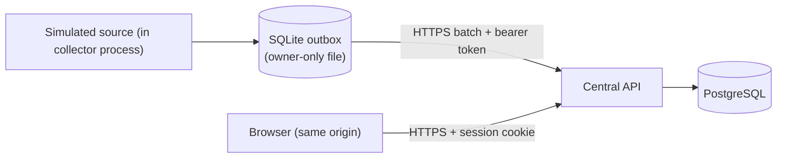

# Initial threat and data-flow model (M0)

Scope: simulator-only release. No instrument writes exist anywhere in the code base.

| Boundary | Threat | Control in M1 | Planned |
| --- | --- | --- | --- |
| Collector → API | Forged or replayed batches | Per-collector bearer token (SHA-256 at rest, revocable, expiring); body collector must equal credential; identity ledger + receipts make replay idempotent | mTLS or token rotation runbook (M3) |
| Collector → API | Oversized/compressed bombs, NaN, schema abuse | 1 MiB raw and decoded caps, bounded gzip inflation, strict schema, finite numbers, ≤500 records | rate limits per collector |
| Collector → API | Data for instruments not assigned | Assignment window + optional sequence cutoff checked per record | supervised recovery import |
| Collector config | Token leakage | Token in a separate 0600 file, refused if group/other readable; never logged or in URLs | OS service identity (M3) |
| Collector | Plain HTTP | Refused unless `allow_insecure_http = true` (dev only) | approved TLS endpoint + CA file |
| Browser → API | Cross-lab data access | Every ID-bearing endpoint checks lab grants; unknown and forbidden both return 404 | role matrix for write features (M2) |
| Browser → API | CSRF | SameSite=Strict HttpOnly cookie + required `X-Labmon-Request` header + Origin check on writes | — |
| Browser → API | Credential stuffing | Argon2id, 5 failures / 15 min / user → 429, audit log | site SSO if approved |
| Browser | XSS / external loads | CSP `default-src 'self'`, no inline script, no CDN, React escaping | — |
| CSV export | Spreadsheet formula injection | Text fields prefixed with `'` when starting with `= + - @ \t \r`; export audited | durable export worker + manifest (M2) |
| Database | Accidental destructive migration | Downgrade of 0001 documented as test-only; migrations reviewed | expand/contract policy, rollback floor |

Data classes: synthetic telemetry (not sensitive), user credentials (hashed), collector tokens
(hashed), audit events. No confidential site material is in fixtures.
